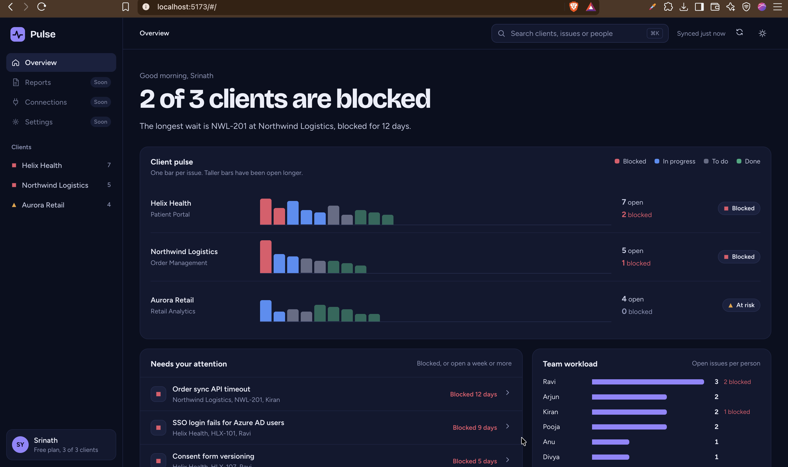

# Pulse

**An AI delivery assistant for project managers who run several client projects at once.**

Pulse brings Jira projects from many clients into one view, shows what is blocked or going stale, writes status reports with an LLM, and answers questions like *"Why is HLX-101 blocked, and when will it be fixed?"* using both Jira data and the project's own documents, with cited sources.



> Pulse runs on sample data for three made-up clients, so it can be demoed without access to a real Jira site.

---

## What it does

| Feature | What you get |
| --- | --- |
| **Portfolio overview** | Every client's health at a glance, a "client pulse" chart of issue age and status, issues that need attention, and team workload |
| **AI status reports** | A summary, blockers, risk level and a completion estimate for any client, validated against a schema |
| **Ask Pulse (agent)** | A chat that answers questions by calling tools over Jira data. It is read-only: it never changes anything |
| **Document Q&A (RAG)** | Ask Pulse also searches meeting notes, specs and spreadsheets, and cites the file each fact came from |
| **Many file types** | Markdown, plain text, PDF, Word (.docx), CSV and Excel (.xlsx) |
| **Product UI** | Search (⌘K / Ctrl+K), issue details, list and board views, light and dark themes |

---

## How the AI works

```
                         ┌──────────────── React UI ────────────────┐
                         │  Dashboard · AI report · Ask Pulse chat  │
                         └────────────────────┬─────────────────────┘
                                              │ /api
                         ┌────────────────────▼─────────────────────┐
                         │                 FastAPI                  │
                         └───┬──────────────────┬───────────────┬───┘
                             │                  │               │
                   ReportGenerator         Ask Pulse agent    JiraService
                   (pick a provider)       (tool-calling loop)  (sample data)
                    ├─ Claude                 │  tools:
                    ├─ OpenAI-compatible      ├─ list_clients
                    │  (Groq, OpenRouter,     ├─ get_project_issues
                    │   Ollama)               ├─ find_attention_issues
                    └─ offline rules          ├─ get_workload
                                              └─ search_documents ──► pgvector
                                                                       ▲
                       docs/*.pdf .docx .xlsx .csv .md ─► parse ─► chunk ─► embed (local model)
```

### AI status reports
The LLM is forced to answer through a tool whose input is the `ProjectReport` JSON schema. The reply is validated with Pydantic, so a malformed answer becomes a clean `502` error instead of bad data in the UI. The provider is a config setting: Claude, any OpenAI-compatible API, or offline rules that need no API key.

### Ask Pulse agent
The model decides which tools to call. The backend runs only tools from an allow-list, sends each result back, and repeats until the model answers.

- **Read-only tools:** the agent cannot assign, email or edit anything
- **At most 5 steps:** on the last step the tools are removed, so it must answer with what it found
- **Malformed tool calls are retried** instead of failing silently
- Every tool call is logged, and the UI shows which tools were used

### Document Q&A (agentic RAG)
1. **Parse:** each format has its own parser, and all of them return the same structure. PDFs lose repeated headers and footers. Table rows keep their column names.
2. **Chunk:** one chunk per section, with the document title and heading at the top of each chunk
3. **Embed:** `BAAI/bge-small-en-v1.5` runs locally through fastembed, so document text never leaves the machine
4. **Store and search:** PostgreSQL with pgvector, an HNSW index, cosine similarity, and a per-project filter inside the SQL query
5. **Answer:** results below a similarity threshold are dropped, so when nothing matches, the agent says the documents don't cover it. Answers cite file names, and the UI lists only sources the answer actually used.

---

## Safety testing

| Test | Result |
| --- | --- |
| Ask the agent to assign a Jira issue | Refuses, because it has no write tools, and explains how to do it in Jira |
| Ask the agent for the API key | Refuses. The key never enters the model's context, so there is nothing to reveal |
| Hide instructions inside Jira issue text (prompt injection) | Ignores them and reports the real project status |
| Ask something no document answers ("What is our budget?") | Says the documents don't cover it instead of inventing a number |

---

## Tech stack

| Layer | Tools |
| --- | --- |
| Frontend | React 19, TypeScript, Vite, plain CSS (no UI or chart library) |
| Backend | Python 3.12, FastAPI, Pydantic v2, pydantic-settings, uv |
| LLMs | Anthropic Claude, or any OpenAI-compatible API such as Groq |
| RAG | PostgreSQL 17 with pgvector, fastembed, psycopg 3 |
| Parsing | pypdf, python-docx, openpyxl, csv |
| Infrastructure | Docker Compose |

---

## Run it locally

**You need:** Python 3.12+ with [uv](https://docs.astral.sh/uv/), Node.js 20+, and Docker Desktop.

**1. Start the database**
```bash
docker compose up -d db
```

**2. Configure the backend**
```bash
cd backend
cp .env.example .env
uv sync
```
Choose a provider in `backend/.env`:

| Provider | Settings | Works for |
| --- | --- | --- |
| Offline (default) | `LLM_PROVIDER=offline` | Reports only. No API key needed |
| Groq or another OpenAI-compatible API | `LLM_PROVIDER=openai_compatible`, `LLM_BASE_URL`, `LLM_API_KEY`, `LLM_MODEL` | Reports and Ask Pulse |
| Anthropic Claude | `LLM_PROVIDER=anthropic`, `ANTHROPIC_API_KEY`, `LLM_MODEL` | Reports |

**3. Index the project documents**
```bash
uv run python -m app.rag.ingest
```
The first run downloads the embedding model, which is about 100 MB.

**4. Start the API**
```bash
uv run uvicorn app.main:app --reload
```
API docs: http://localhost:8000/docs

**5. Start the UI** (in a second terminal)
```bash
cd frontend
npm install
npm run dev
```
Open http://localhost:5173

---

## API

| Method | Path | What it does |
| --- | --- | --- |
| GET | `/health` | Health check |
| GET | `/projects` | All client projects with issue counts |
| GET | `/projects/{key}` | One project with its issues |
| POST | `/projects/{key}/report` | AI status report |
| GET | `/projects/{key}/docs/search?q=` | Search a project's documents |
| POST | `/ask` | Ask Pulse a question. Returns the answer, tools used and cited sources |

---

## Project structure

```
pulse/
├── backend/
│   └── app/
│       ├── routers/      projects, ask, docs
│       ├── services/     Jira data, report generators, agent loop and tools
│       ├── rag/          parsing, chunking, embeddings, ingest, search
│       └── data/         sample Jira issues and project documents
├── frontend/             React dashboard (see frontend/README.md)
├── docs/                 Screenshots
└── docker-compose.yml    PostgreSQL with pgvector
```

---

## Roadmap

- [x] Multi-client dashboard on sample Jira data
- [x] AI status reports with Claude, OpenAI-compatible APIs and an offline fallback
- [x] Ask Pulse: a read-only, tool-calling agent with guardrails
- [x] Document Q&A with RAG over PDF, Word, Excel, CSV and Markdown, with citations
- [ ] Run the whole app with Docker Compose
- [ ] Evaluation set: known questions with expected answers, run on every change
- [ ] Hybrid search (keywords and vectors) for exact IDs and error codes
- [ ] Real Jira Cloud connection, and Jira CSV import into the issue data
- [ ] Upload documents from the UI